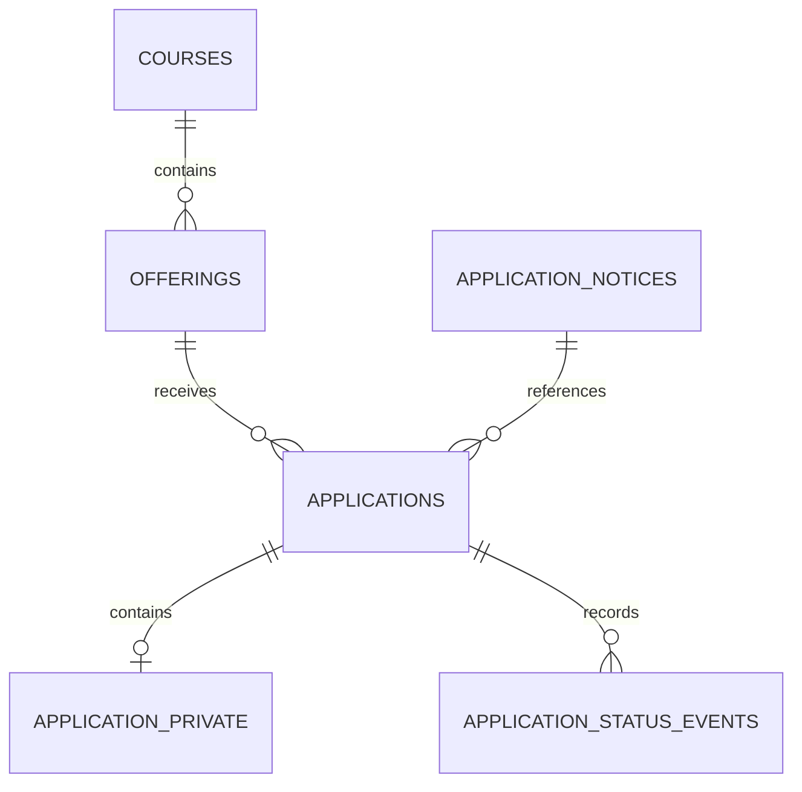

# B-04 1일차 신청 데이터·권한 설계

기준일 2026년 11월 11일. 기준은 Draft PR #35의 `cd7f03a7f77e6344d1c61d367a4d34f85cc0d4d8`이다. 이번 산출물은 신규 SQL 후보와 격리 검수이며 공개 신청 연결은 후속 단계다.

## 범위와 현재 관리자 보호 장치

- `supabase/drafts/b04_day01_application_schema.sql`은 기존 강좌·기수에 연결할 네 테이블의 후보이다. 자동 적용되는 `supabase/migrations` 경로에 등록하지 않는다.
- 실제 개발 DB는 마이그레이션 5건, 강좌 5개, 주차 60개, 비공개 기수 1개이며 신청 테이블은 없다. 기존 데이터는 조회 기준선으로만 사용한다.
- 현재 `private_education.save_offering_v2`는 `academy.applications` 또는 `academy.application_private`가 있으면 SQLSTATE 55000으로 저장을 차단한다. 따라서 후보 DDL만 개발 DB에 적용하면 기존 관리자 등록·수정이 차단된다. 실제 적용 검토는 공통 잠금·정원 검증을 포함한 v2 통합 변경과 묶어서 진행해야 한다.
- 기존 `day11/day12/day14` SQL과 이 후보는 같은 객체를 정의하므로 함께 적용하지 않는다. 이후 정식화할 때 실제 적용 이력 5건을 기준으로 하나의 변경 집합을 만든다.

## 관계와 최소 정보

| 후보 테이블 | 저장 내용과 제약 |
| --- | --- |
| `academy.application_notices` | 안내 버전, 본문, 보존 안내, 게시 시각. 게시 시각이 없는 버전은 운영 접수에 사용하지 않는 설계다. 이후 서버가 활성 버전을 정하고 게시된 안내의 수정·삭제 권한을 제한해야 한다. |
| `academy.applications` | 기수 UUID, 요청 UUID, 상태, 동의한 안내 버전·시각, 접수 시각, 취소·자리 반환 시각, 미확정 보존 기한. 기수와 안내 FK는 삭제 제한이며 동일 기수·요청 UUID는 고유하다. |
| `academy.application_private` | 이름과 연락처만 보유한다. 신청 UUID·기수 UUID 복합 FK로 다른 기수의 개인정보가 붙는 오류를 막는다. 이메일·주소·생년월일·IP는 이번 수집 구조에 포함하지 않는다. |
| `academy.application_status_events` | 신청, 이벤트 종류, 전후 상태, 시스템 또는 관리자 구분, 처리자 UUID, 시각을 저장한다. 이름·연락처·자유 서술 사유는 복제하지 않는다. 실제 관리자 UUID는 후속 함수에서 검증된 세션으로 결정한다. UUID 필드 자체가 관리자 권한을 증명하지 않는다. |

개인정보 행은 DDL상 신청당 최대 한 건이다. 성공한 접수에 반드시 개인정보와 최초 이력이 함께 존재한다는 보장은 후속 저장 함수의 단일 트랜잭션으로 구현한다. 테이블 분리는 열람 범위를 구분하는 기반이며 그 자체가 암호화나 접근 통제를 대신하지 않는다.

## 정책 결정표

| 항목 | 확정 기준 | 1일차 후보의 시험 가정 | 운영 전에 결정할 내용 |
| --- | --- | --- | --- |
| 신청 방식 | 비회원 우선 | 가상 UUID와 이름·전화만 사용 | 실제 안내·문의·본인 확인 담당 |
| 중복 | 같은 기수·같은 이름·연락처 중복 방지 | 이름 앞뒤 공백 제거, 내부 공백·대소문자·유니코드 보존, 전화 구분문자 제거 후 숫자 9~15자리. DB에는 정규형만 허용 | 이름 NFKC 여부, 국제번호·공동 연락처, 동명이인 예외, 취소 후 재신청 |
| 재전송 | 동일 요청이 자리를 두 번 점유하지 않음 | `(offering_id, request_id)` 고유 제약 | 같은 키·다른 본문 거절, 요청 키 보존 기한과 안내 버전 변경 뒤 결과 회복 |
| 취소 | 운영 정책 미확정 | `cancelled_at` 기록과 자리 반환은 별도 필드. 취소만 하면 `seat_released_at`은 NULL로 유지 | 취소 가능 주체·기한·증빙, 자리 반환 시각, 마감 뒤 재개·대기자 |
| 재신청 | 미확정 | 개인정보의 기수·이름·연락처 고유 제약을 취소 뒤에도 유지 | 재신청을 허용하면 이력 보존과 활성 중복 제약을 함께 재설계 |
| 동의 | 최소 수집·안내 버전과 확인 시각 보존 | 가상 안내와 가상 보존 문구만 사용 | 수집 목적·근거, 동의 문구, 필수 항목, 담당자 |
| 보존·파기 | 미확정 | `retention_due_at` 기본 NULL, 자동 삭제 없음 | 기준일·기간, 취소·수료 후 처리, 원문·이력·백업별 보존과 복원 후 삭제 반영 |

시험 가정은 최종 기관 정책이 아니다. 보존 기간과 취소 정책의 미결정을 임의 숫자나 자동 자리 반환으로 채우지 않는다.

## 상태·정원·취소 규칙 초안

| 동작 | 상태·점유 처리 | 검증 및 이력 |
| --- | --- | --- |
| 신규 접수 | `received`, 자리 점유 | 공개 강좌·공개 기수·`open`, 모집 시작 포함·종료 제외, 동의 버전, 정원·중복 검사 후 신청·개인정보·최초 이력 함께 저장 |
| 관리자 확인 | `received → reviewed`, 점유 유지 | 현재 사용자·신청 처리 권한 검증. 동일 확인 경합은 한 번만 변경하고 한 건의 이력 기록 |
| 취소 요청 확인 | `received/reviewed → cancelled` 후보 | 취소 권한·확인 절차 확정 후 구현. 취소만으로 자리 반환을 의미하지 않음 |
| 자리 반환 | `seat_released_at` 기록, 한 자리 해제 후보 | 확정된 정책이 허용하는 경우에만 처리. 같은 기수 잠금 아래 취소·반환 이력을 원자적으로 기록 |

점유 원천은 `seat_released_at IS NULL`인 해당 기수 신청 행 수로 제안한다. `received/reviewed`에서는 반환 시각을 허용하지 않는다. 취소 후에도 반환 승인 전에는 점유한다. 잔여석 표시에는 실제 인원이나 개인정보를 공개하지 않고 정원에서 점유 수를 뺀 값만 검토한다. 운영 데이터에서 정원 미만 변경을 단순히 0으로 감춰서는 안 되며 저장 경로에서 거절한다.

DDL은 상태 필드와 이벤트 종류의 허용값·기본 조합만 검사한다. 상태 전이의 순서, 이벤트와 실제 행의 일치, 권한·정원·모집기간은 후속 원자적 함수가 보장해야 한다. 현재 후보는 API 역할에 어떤 쓰기도 부여하지 않는다.

## 마지막 1자리 거래와 재시도 설계

1. 서버가 입력·동의·활성 기능을 검사한다. 요청 UUID는 재시도 동안 유지한다. 최초 접수와 결과 회복을 구분해, 이미 성공한 요청을 모집 마감·안내 변경만으로 실패 처리하지 않는다.
2. 강좌 공유 잠금 후 기수 행 잠금의 순서를 정한다. 잠금을 기다린 뒤 기수의 강좌·공개 상태·모집 시각을 다시 검사한다. 다중 행 작업은 UUID 등 일관된 순서로 잠근다.
3. 같은 기수·요청 ID의 기존 결과를 먼저 조회한다. 이름·연락처·동의 버전 등 본문이 다르면 동일 키로 새 신청을 만들지 않는다. 신청 원문과 존재 여부를 익명 응답으로 노출하지 않는다.
4. 신규 요청만 DB 시각, `open`, 시작 < 종료, 기간 경계, 업무상 중복, `count(seat_released_at IS NULL) < capacity`를 검사한다. 신청·개인정보·최초 이력을 저장하고 함께 커밋한다.
5. 두 번째 세션은 기수 행 잠금을 기다린 뒤 먼저 커밋된 신청 수를 보게 되므로 마지막 한 자리가 찼다면 접수하지 않는다. 예외·PII 저장 실패 시 트랜잭션 전체를 롤백한다.
6. 관리자 v2 정원 변경·강좌 이동·취소도 같은 기수 잠금과 점유 기준을 사용하도록 후속 단계에서 통합한다. 현재의 속성 기반 advisory lock만으로 접수와의 정원 경합을 보장할 수 없다. 임의 직접 테이블 쓰기를 허용하지 않는다.

동시성 시험은 후속 저장 함수가 준비된 뒤 두 PostgreSQL 연결로 잠금 대기를 관찰한다. 마지막 1석, 같은 이름·연락처의 다른 요청 키, 동일 키 재전송, 취소·정원 축소·마감 경합, 실패 롤백을 시험한다. 단일 PGlite 연결의 순차 INSERT 시험을 마지막 1자리 동시성 통과로 해석하지 않는다.

## 역할과 데이터 접근

| 주체 | 이번 후보의 실제 권한 | 후속 설계 |
| --- | --- | --- |
| 익명·일반 사용자 | 네 신규 테이블 직접 접근 거부 | Server Action을 통한 제한 접수. 개인 신청 목록·원문 직접 조회 거부 |
| 기존 기수 관리자 | 기존 멤버십·조회 유지. 신규 신청 정보 직접 접근 거부 | 신청 목록, 상태 처리, 원문 열람 권한을 별도로 검토 |
| `service_role` | 신규 테이블 권한을 명시적으로 회수 | RLS 우회 키의 브라우저 전달 금지. 전용 최소 권한 저장 경로 설계 |
| `academy_offering_executor` | 신규 테이블 권한을 명시적으로 회수 | 기존 v2 보호 장치 검토 후 필요한 점유 수 조회만 별도 설계 |
| 격리 DB 소유자 | 가상 fixture 구성·검수 | 소유자 시험은 실제 JWT·RLS 통합 검수와 구분 |

상태·정원·PII 쓰기는 검증된 최소 권한 함수에서 처리하고, 함수의 고정 `search_path`, 명시적 스키마, EXECUTE 회수와 호출자·현재 멤버십 검증을 유지한다. 사용자 수정 가능 메타데이터와 브라우저의 actor UUID를 권한 근거로 사용하지 않는다. 관리 목록은 이름 마스킹·연락처 끝자리만 표시하는 기존 방향을 유지하며, 로그에는 키·JWT·쿠키·이름·연락처·본문을 남기지 않는다.

## 적용과 롤백 계획

- 후보 실행은 하나의 트랜잭션으로 한다. 같은 이름의 기존 객체가 있으면 실패하며 `IF NOT EXISTS`로 다른 스키마를 묵인하지 않는다. 권한 회수 전 테이블이 노출되지 않도록 커밋 경계를 지킨다.
- 작성한 롤백은 네 후보 테이블이 모두 비어 있을 때만 동작한다. 새로운 함수·정책 등 종속성이 추가되면 DROP RESTRICT가 실패하므로 별도 검토한다. 기존 강좌·기수·RLS·관리자 함수는 변경하지 않는다.
- 격리 시험에서 빈 후보를 제거하면 기존 v2 저장이 다시 성공하는지 확인한다. 저장된 행이 있으면 중단하며 `CASCADE`·TRUNCATE로 승인되지 않은 삭제를 수행하지 않는다.
- 실제 수집 이후에는 쓰기 중단·상태 확인·암호화된 백업·전진 수정 또는 검토된 복구를 우선한다. 실제 개발 DB의 마이그레이션과 데이터 삭제는 대상·파일·권한·복구·검수 내용을 제시하고 별도 승인받는다.

## 참조

- [PR #35](https://github.com/c7609chj8-dot/ai-education-hub/pull/35)
- [기존 관리자 v2 마이그레이션](https://github.com/c7609chj8-dot/ai-education-hub/blob/cd7f03a7f77e6344d1c61d367a4d34f85cc0d4d8/supabase/migrations/20261108183527_b03_5_admin_membership_and_offerings_v2.sql)
- [PostgreSQL 17 잠금](https://www.postgresql.org/docs/17/explicit-locking.html)
- [Supabase RLS](https://supabase.com/docs/guides/database/postgres/row-level-security)
