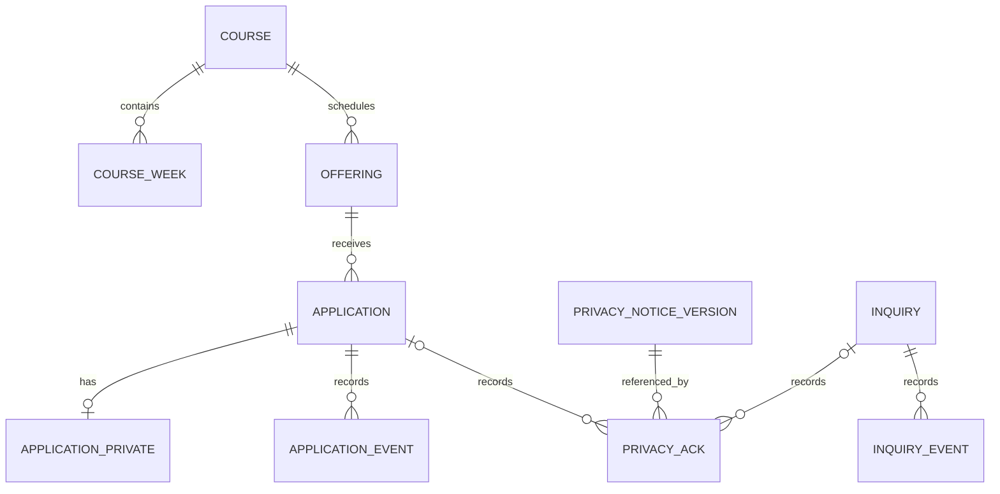

# 백엔드 3일차 데이터 모델·상태·보존 정책 초안

작성일: 2026년 11월 7일

상태: **논리 설계 초안**. 운영 정책과 실제 구현은 후속 확정이 필요합니다. 오늘은 Supabase 프로젝트, 테이블, 정책, 마이그레이션을 생성하거나 변경하지 않습니다.

## 1. 확정된 기준과 남은 결정

| 항목 | 상태 | 내용 |
| --- | --- | --- |
| 신청 방식 | 확정 | 수강생은 비회원 신청부터 시작 |
| 환경 | 확정 | 개발·운영 데이터베이스 분리. 대상 프로젝트·계정·비용은 미정 |
| 정원 | 확정 | 신청이 실제 접수되는 즉시 자리 확보 |
| 중복 | 확정 | 같은 기수에 같은 이름과 연락처로 중복 신청 방지 |
| 개인정보 | 미확정 | 실제 필수 항목, 수집 근거, 안내 문구, 보유 기간과 파기 절차 |
| 비회원 조회·취소 | 미확정 | 본인 확인 수단, 온라인 조회·취소 여부 및 운영자 처리 절차 |
| 중복 세부 규칙 | 미확정 | 이름·연락처 표기 차이 처리, 공동 연락처, 취소·반려 후 재신청 여부 |
| 정원 세부 규칙 | 미확정 | 취소·반려 시 자리 복귀, 정원 축소와 대기자 처리 |
| 관리자 | 미확정 | 역할별 권한과 담당자. 실제 관리자 화면은 시연 화면과 분리 |

이름과 연락처가 같다는 조건은 사용자 결정입니다. 다만 동일 연락처를 공유하는 사람이나 같은 이름을 가진 사람의 처리, 연락처 형식·공백 정규화 방식은 기관 정책을 확인해야 합니다. 전화번호·이름만으로 본인임을 증명하지 않으며, 중복 오류에서 기존 신청 내용이나 신청 존재 여부를 불필요하게 노출하지 않습니다.

## 2. 논리 관계도

다음 이름은 이해를 위한 **후보**이며 실제 테이블·열·권한과 스키마는 구현 전 검토합니다.

신청과 문의는 서로 독립된 대상입니다. `PRIVACY_ACK`는 신청 또는 문의 중 정확히 하나에만 연결하도록 제안하며, 실제 수집 근거·안내·동의 정책 확정 후 대상이 중복되거나 빠지지 않도록 제약을 검토합니다. 위 그림의 관계는 후보이며 어느 법적 근거에나 동의가 필요하다고 확정하는 의미가 아닙니다.

## 3. 엔터티와 필드 후보

`필수 후보`는 구현을 위한 제안이지 실제 개인정보 수집 항목의 확정이 아닙니다. DB 제약과 자료형은 정책 확정 및 마이그레이션 작성 시 검증합니다.

| 엔터티 후보 | 주요 필드 후보 | 관계·제약 초안 | 접근 범위 초안 |
| --- | --- | --- | --- |
| 강좌 `course` | 식별자, 고유 slug, 제목, 분야, 소개, 대상, 목표, 공개 상태 | slug 고유. 기존 5개 강좌는 검토 후 이관 | 공개된 강좌만 방문자 조회; 수정은 허가된 관리자 |
| 강좌 주차 `course_week` | 식별자, 강좌 식별자, 주차 번호, 제목·내용 | 강좌 내 주차 번호 중복 방지. 기존 12주를 이관하되 모든 미래 과정이 반드시 12주일지는 미정 | 공개된 강좌의 공개 내용만 조회 |
| 기수 `offering` | 식별자, 강좌 식별자, 모집 시작·종료, 교육 시작·종료, 장소, 정원, 운영 상태 | 강좌와 연결; 정원 0 이상, 기간의 선후 관계 검사 | 공개 가능한 기수 정보만 방문자 조회 |
| 신청 `application` | 식별자, 기수 식별자, 접수 시각, 처리 상태, 신청 경로·처리 시각 | 비회원 신청. 신청 저장과 자리 확보를 동일 트랜잭션에서 처리 | 방문자 목록 조회 불가; 역할에 맞는 관리자만 처리 |
| 신청 개인정보 `application_private` | 신청 식별자, 이름·연락처 등 확정된 최소 항목 | 신청 정보와 분리하는 방안. 필수 항목·보유·삭제 정책 미확정 | 업무상 허가된 관리자와 제한된 서버 처리만 접근 |
| 신청 이력 `application_event` | 신청 식별자, 상태 변경, 수행자 구분, 시각 | 허용된 상태 변경을 기록. 개인정보 원문은 복제하지 않음 | 감사 목적에 맞는 최소 권한 |
| 문의 `inquiry` | 식별자, 유형, 내용, 이름·이메일 등 확정된 최소 연락 항목, 접수 시각, 상태 | 실제 수집 항목은 기관 결정. 문의 내용도 개인정보가 포함될 수 있음 | 방문자 목록 조회 불가; 허가된 관리자만 처리 |
| 문의 이력 `inquiry_event` | 문의 식별자, 상태 변경, 수행자 구분, 시각 | 문의 원문·연락처를 이력에 불필요하게 복제하지 않음 | 감사 목적에 맞는 최소 권한 |
| 개인정보 안내 버전 `privacy_notice_version` | 버전, 안내 내용 또는 참조, 적용 시작·종료 | 적용 당시 고지·동의 문구와 법적 근거 기록 방식은 확정 필요 | 공개 안내와 내부 관리 범위 분리 |
| 안내·동의 이력 `privacy_ack` | 대상 식별자, 안내 버전, 근거·확인 결과·시각 | 신청 또는 문의와의 관계를 명확히 설정. 실제 저장 항목·근거는 법률·운영 검토 후 확정 | 허가된 관리자만 필요한 범위에서 조회 |
| 관리자·역할 | 인증 사용자 식별자, 역할·활성 상태 | Supabase Auth 사용자와 역할 관리 방식을 후속 설계 | 서버 측 세션 검증과 역할 확인 필수 |

`application_private` 분리는 접근 통제를 돕는 설계 후보이며, 분리 자체가 암호화·익명화 또는 RLS 설정을 대신하지는 않습니다. 비회원 신청 식별자는 임의 UUID 등을 사용하더라도 식별자를 아는 것만으로 개인 정보를 조회·수정할 수 있어서는 안 됩니다.

## 4. 상태와 전이 초안

아래 상태는 **제안**입니다. 정원 확보 시점과 중복 방지만 확정되었고, 상태 명칭과 전이 권한은 기관 운영 정책에 맞춰 결정합니다.

### 4.1 강좌·기수

- 강좌: `작성 중` → `공개` → `보관`을 기본 흐름으로 제안합니다. 공개 취소·복원 허용 여부는 미정입니다.
- 기수: `작성 중` → `모집 예정` → `모집 중` → `모집 마감` → `교육 종료`를 기본 흐름으로 제안합니다. 운영자가 취소하는 경우와 재개 여부는 별도 결정합니다.
- 공개 여부, 운영 상태, 모집 기간, 남은 자리를 구분합니다. `정원 마감`은 확정된 정원·신청 상태 집계에 근거해 표시하며, `마감 임박`의 기준은 아직 정하지 않았습니다.
- 모집 기간은 시간대가 분명한 시각으로 저장하는 방안을 제안하고, 한국 시간 표시 및 시작·종료 경계는 실제 운영 정책에 따라 검수합니다. 날짜만 필요한 교육 일정은 날짜와 시각을 구별합니다.

### 4.2 수강신청

- 방문자의 유효한 요청이 DB에 실제 커밋되면 `접수` 상태와 자리 확보가 함께 성립합니다. 저장 실패·정원 마감·기수 비공개 등에서는 신청도 자리 확보도 완료되지 않습니다.
- `접수` → `운영자 확인` 같은 처리 상태, `취소`·`반려` 전이 및 권한은 제안이며 기관 확인 후 확정합니다. 접수는 교육 확정이나 결제 완료를 뜻하지 않습니다.
- 취소·반려 시 정원 복귀 여부와 재신청 허용 조건은 **미확정**입니다. 규칙을 결정하기 전에는 임의로 자동 처리하지 않습니다.
- 동시에 같은 기수의 신청·취소·정원 변경이 발생하는 경우에도 하나의 일관된 정원 기준을 유지합니다.

### 4.3 문의

- `접수` → `처리 중` → `처리 완료`를 제안합니다. 재열기·삭제 가능 역할과 실제 답변 채널은 미정입니다.
- 저장된 문의만 접수 완료로 표시하며, 메일·문자 자동 발송은 별도 결정 범위입니다.

## 5. 정원·중복·재시도 처리 설계

### 5.1 원자적 신청 처리 — 구현 후보

1. 서버는 기능 활성 상태와 기수 공개·모집 기간, 입력 형식, 확정된 개인정보 안내를 검증합니다.
2. 데이터베이스 단일 트랜잭션에서 **해당 기수 행 잠금 또는 동등하게 검증된 원자적 방식**으로 기수의 현재 상태와 자리를 다시 확인합니다. 신청·취소·정원 변경도 같은 일관성 규칙을 따라야 합니다.
3. 같은 기수·이름·연락처 중복 기준을 적용하고 유효한 신청만 저장합니다. 비교용 정규화와 예외 정책은 확정 전입니다. 경쟁 상황에서도 서버 검사만 믿지 않고 적합한 데이터베이스 제약·잠금을 함께 설계합니다.
4. 신청과 자리 확보를 함께 커밋하고, **커밋 성공 후에만** 접수 완료를 응답합니다. 오류·취소 시 둘 다 반영되지 않아야 합니다.
5. 응답이 유실된 재시도는 같은 요청인지 구분하는 별도의 멱등성 방안을 설계합니다. 이는 같은 이름·연락처의 업무상 중복 방지와 다른 문제입니다. 보관 기간·키 범위·서로 다른 요청의 처리 기준은 미정입니다.

`정원`과 `확보된 자리 수`의 원천을 하나로 정하고, 실시간 집계 또는 별도 카운터 중 선택한 방식이 모든 상태 전이에서 일치하는지 확인합니다. 카운터를 쓸 경우 신청·취소·정원 조정과의 동기화 및 복구 방법이 필요합니다. 잠금·제약·색인과 상세 구현은 마이그레이션 작성 시 검토합니다.

### 5.2 필수 검수 사례

- 마지막 자리 1개에 서로 다른 두 요청이 동시에 도착하면 최대 1건만 접수됩니다.
- 같은 기수·같은 이름·같은 연락처의 동시 신청은 중복으로 접수되지 않습니다. 이름·연락처의 비교 방법은 확정된 규칙을 사용합니다.
- 저장 실패와 트랜잭션 중단 시 신청과 자리 확보가 함께 반영되지 않습니다.
- 요청 응답이 끊긴 후 동일 요청을 재시도해도 의도하지 않은 중복 신청·정원 차감이 없어야 합니다.
- 모집 기간 경계, 비공개·마감, 정원 변경과 동시에 들어오는 신청을 검사합니다.
- 취소·반려·대기자·재신청은 정책 확정 후 자리 복귀와 중복 기준을 추가 검수합니다.

## 6. 개인정보 보유·파기 초안

**기간이나 법적 근거는 아직 확정되지 않았습니다.** 신청·문의 항목별 수집 목적과 근거, 필수 여부, 안내·동의 방식, 보유 기간과 산정 시점을 기관이 정하고 필요한 법률·개인정보 검토를 거칩니다. 개인정보가 불필요하게 된 경우의 처리와 다른 법령에 따른 보존 필요 여부도 함께 검토합니다. [개인정보 보호법 제21조](https://law.go.kr/LSW/lsSideInfoP.do?docCls=jo&joBrNo=00&joNo=0021&lsiSeq=283839&urlMode=lsScJoRltInfoR)

| 범주 | 목적·대상 | 보존·삭제 결정 필요 사항 |
| --- | --- | --- |
| 신청·문의 원문 | 실제 접수와 응대에 필요한 최소 정보 | 기간·기준일, 처리 완료·취소 후 보유 및 삭제 기준 |
| 개인정보 안내·동의 이력 | 적용한 안내와 확인 사실 | 필요한 보존 범위·기간, 신청 삭제와의 관계 |
| 관리자 작업·접근 이력 | 업무 추적 및 보안 확인 | 접근 가능한 역할, 최소 항목, 보존·점검 기간 |
| 오류·보안 로그 | 장애 및 오용 분석 | 개인정보·비밀값 마스킹, 접근 제한과 보존 기간 |
| 백업 | 장애 복구 | 암호화·접근 통제·유효기간·복원 후 삭제 반영 방법 |
| 테스트 데이터 | 개발·Preview 검수 | 실제 개인정보 사용 금지, 테스트 종료 후 정리 기준 |

삭제 시 관련 신청·문의 본문, 첨부파일, 로그·이력과 백업의 관계를 검토합니다. 백업은 즉시 삭제된다고 가정하지 않으며, 복원 시 삭제 대상이 다시 노출되지 않도록 별도의 관리 절차를 설계합니다. 법령상 보존 의무가 있는 자료의 분리 보관 여부도 기관 검토 후 정합니다.

## 7. 접근 경계와 데이터 전환

- 공개 방문자는 공개된 강좌·기수·콘텐츠만 조회하고 신청·문의는 제한된 접수 경로를 통해 제출합니다. 신청·문의의 목록이나 개인정보 직접 조회는 허용하지 않는 방향으로 설계합니다.
- 관리자 요청은 서버에서 사용자 세션과 역할을 검증하고, 데이터 노출 범위에 맞춰 Data API 객체 권한과 RLS를 함께 검토합니다. 클라이언트의 버튼 숨김, 공개 키 또는 UUID만으로 접근 권한을 부여하지 않습니다. [Supabase API 보안](https://supabase.com/docs/guides/api/securing-your-api)
- 서버의 고권한 키가 RLS를 우회할 수 있음을 고려해 최소 권한을 우선하고, 권한이 필요한 처리도 인증·인가와 비밀값 노출 방지를 별도로 검수합니다.
- 기존 5개 강좌·60주 내용은 검토 후 개발 DB에 이관할 후보입니다. 기수 날짜·정원·모집 상태, 가상 신청·후기, 연락처는 실제 운영 데이터로 자동 이관하지 않습니다.
- 현재 정적 경로 `dynamicParams = false`와 `generateStaticParams`는 실제 DB 기반 공개·비공개 변경에 맞춰 재설계하고, 잘못되었거나 비공개인 강좌·기수의 직접 접근과 404를 운영 모드에서 검수합니다.
- 개발·Preview에는 가상 데이터만 사용하며, 테스트가 운영 DB에 쓰지 못하도록 환경과 자격증명을 분리합니다.

## 8. 아직 결정할 사항과 다음 작업

| 항목 | 결정 필요 내용 | 담당 |
| --- | --- | --- |
| 개인정보·신청 | 실제 필수 항목, 법적 근거, 안내·동의와 보유 기간 | 기관 운영·개인정보 담당자 지정 필요 |
| 중복·식별 | 이름·연락처 표기 차이, 공동 연락처, 취소·반려 후 재신청 | 기관 운영 책임자 지정 필요 |
| 정원·상태 | 취소·반려 시 자리 복귀, 정원 조정, 대기자·모집 마감 정책 | 기관 운영 책임자 지정 필요 |
| 비회원 확인 | 본인 조회·취소 제공 여부와 안전한 본인 확인 방법 | 기관 운영 책임자 지정 필요 |
| 관리자 | 계정·권한·감사 이력 범위 및 복구 담당자 | 기관 운영 책임자 지정 필요 |
| 운영 환경 | 개발·운영 프로젝트 소유 계정, 프로젝트 구성 및 비용 | 기관 계정·비용 담당자 지정 필요 |

완료: 확정된 비회원·DB 분리·즉시 자리 확보·중복 방지를 반영하고, 관계·상태·접근·정원 동시성 및 보존 정책의 검토 가능한 초안을 작성했습니다. 위 미확정 항목은 구현 전 결정하고 반영해야 합니다.

4일차에는 개발 전용 Supabase 환경과 마이그레이션 기반을 준비할 계획입니다. 실제 프로젝트 대상·소유와 비용을 확인하고, 다른 프로젝트나 운영 데이터를 변경하지 않는 범위에서 진행합니다. 전체 일정은 [백엔드 작업계획서](backend-implementation-plan.md)를 참고하세요.

기술 참고: [PostgreSQL 행 잠금](https://www.postgresql.org/docs/current/explicit-locking.html), [PostgreSQL 고유 인덱스](https://www.postgresql.org/docs/current/indexes-unique.html), [Supabase RLS](https://supabase.com/docs/guides/database/postgres/row-level-security), [Supabase API 보안](https://supabase.com/docs/guides/api/securing-your-api). 실제 구현 시 사용 버전과 최신 문서를 다시 확인합니다.
